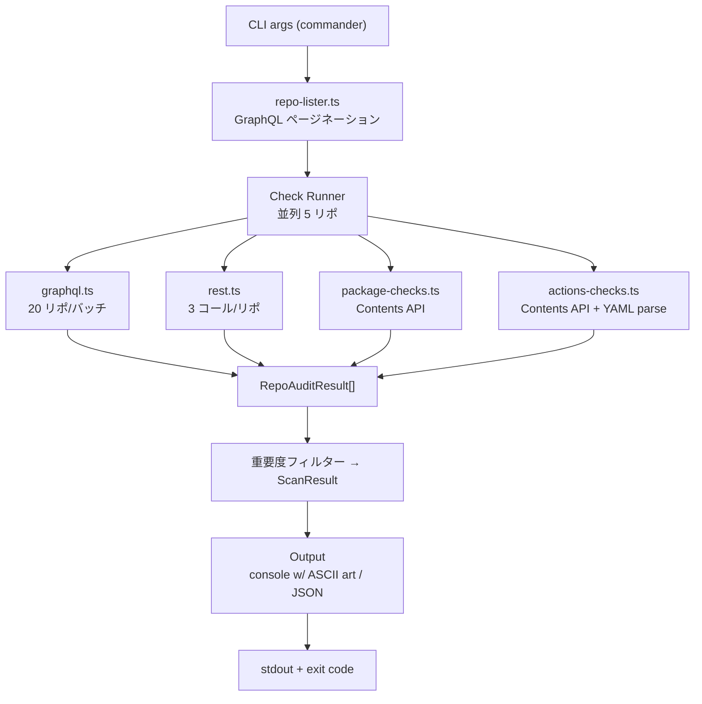

# genkan - お前の家の玄関開いてるぞ

GitHub リポジトリのセキュリティ設定を監査する npx CLI。\
サプライチェーン攻撃対策として最低限の設定が漏れていないかチェックし、\
アスキーアートで煽りながら指摘します。

```
  ____  _____ _   _  _  __    _    _   _
 / ___|| ____| \ | || |/ /   / \  | \ | |
| |  _ |  _| |  \| || ' /   / _ \ |  \| |
| |_| || |___| |\  || . \  / ___ \| |\  |
 \____||_____|_| \_||_|\_\/_/   \_\_| \_|

  -- omae no ie no genkan aiteru zo --
```

## インストール不要で使う

```bash
npx genkan --repo owner/repo
```

## インストールして使う

```bash
npm install -g genkan
genkan --repo owner/repo
```

## 前提条件

- Node.js 20+
- [GitHub CLI (`gh`)](https://cli.github.com/) がインストールされ、認証済みであること

```bash
gh auth login
```

## 使い方

```
Usage: genkan [options]

Options:
  --org <name>          組織のリポを全スキャン
  --user <name>         ユーザーのリポを全スキャン
  --repo <owner/repo>   単一リポをスキャン
  （引数なし）            認証ユーザーのリポをスキャン
  --format <type>       出力形式: console | json  (default: console)
  --severity <level>    フィルター閾値: low | medium | high | critical  (default: low)
  --include-archived    アーカイブ済みリポを含める
  --include-fork        フォークリポを含める
  --create-issues       失敗チェックごとにGitHub Issueを作成
  --dry-run             --create-issuesと併用、Issue作成せずプレビューのみ
  -h, --help            ヘルプ表示
  -V, --version         バージョン表示
```

### 使用例

```bash
# 単一リポをチェック
genkan --repo g-kari/my-app

# 組織全体をスキャン
genkan --org my-org

# ユーザーの全リポをスキャン
genkan --user g-kari

# JSON出力
genkan --repo owner/repo --format json

# critical/high のみ表示
genkan --org my-org --severity high

# 問題のあるリポに自動でIssue作成
genkan --org my-org --create-issues

# Issue作成のプレビュー（実際には作成しない）
genkan --org my-org --create-issues --dry-run
```

## チェック項目 (21項目)

### GitHub設定 (13項目)

| チェックID | 重要度 | 説明 | サプライチェーンリスク |
|---|---|---|---|
| `branch-protection` | **critical** | デフォルトブランチにブランチ保護ルールが設定されているか | 不正なコード変更の防止 |
| `force-push-protection` | **critical** | デフォルトブランチへのフォースプッシュが禁止されているか | コミット履歴の改ざん防止 |
| `secret-scanning` | **critical** | シークレットスキャンが有効か | 認証情報の漏洩検知 |
| `secret-scanning-push-protection` | **high** | シークレットスキャンのプッシュ保護が有効か | 認証情報のプッシュ時検知 |
| `vulnerability-alerts` | **high** | Dependabotの脆弱性アラートが有効か | 依存パッケージの脆弱性検知 |
| `dependabot-security-updates` | **high** | Dependabotのセキュリティアップデートが有効か | 脆弱な依存の自動更新 |
| `actions-default-permissions` | **high** | GitHub Actionsのデフォルト権限がreadか | CI/CDパイプラインの権限最小化 |
| `private-vulnerability-reporting` | **medium** | プライベート脆弱性報告が有効か | 脆弱性報告チャネルの確保 |
| `security-policy` | **medium** | SECURITY.mdが存在するか | 脆弱性報告手順の明示 |
| `dependabot-config` | **medium** | dependabot.ymlが存在するか | 依存パッケージの自動更新 |
| `codeowners` | **medium** | CODEOWNERSファイルが存在するか | コードレビューの担当者明確化 |
| `delete-branch-on-merge` | **low** | マージ後にブランチが自動削除されるか | リポジトリの整理 |
| `license` | **low** | ライセンスが設定されているか | OSS利用条件の明確化 |

### package.json系 (5項目)

| チェックID | 重要度 | 説明 | サプライチェーンリスク |
|---|---|---|---|
| `pkg-lockfile-exists` | **critical** | package-lock.json / yarn.lock / pnpm-lock.yaml が存在するか | 依存バージョンの固定 |
| `pkg-lifecycle-scripts` | **critical** | 危険なlifecycleスクリプトが含まれていないか (curl/wget/sh等) | 悪意あるスクリプトの検知 |
| `pkg-private-field` | **medium** | package.jsonにprivate:trueが設定されているか | 意図しない公開の防止 |
| `pkg-engines-field` | **low** | package.jsonにenginesが設定されているか | 実行環境の明確化 |
| `pkg-exact-versions` | **medium** | 依存パッケージのバージョンが固定されているか (^ ~ * 使用は警告) | 予期しないバージョンアップの防止 |

### GitHub Actions (3項目)

| チェックID | 重要度 | 説明 | サプライチェーンリスク |
|---|---|---|---|
| `actions-pinned-versions` | **critical** | GitHub ActionsがSHAで固定されているか (`@v3` はNG、`@abc123...` がOK) | サプライチェーン攻撃の防止 |
| `actions-trusted-sources` | **high** | GitHub Actionsが信頼できるソースから使用されているか | 不正なActionsの検知 |
| `actions-permissions-scoped` | **high** | workflowにpermissionsブロックが定義されているか | 最小権限の原則 |

## 出力例

### コンソール出力 (デフォルト)

```
  ____  _____ _   _  _  __    _    _   _
 / ___|| ____| \ | || |/ /   / \  | \ | |
 ...

[1/3] owner/my-app
       _____________________________
      |  ___________________________|
      | |        WELCOME            |
      | |       HACKERS!!           |
      ...
  omae no repo, maruhadaka jyan

  CRITICAL  branch-protection         ブランチ保護
            デフォルトブランチにブランチ保護ルールが設定されているか
  CRITICAL  pkg-lockfile-exists       ロックファイル
            package-lock.jsonまたはyarn.lockが存在するか
  HIGH      vulnerability-alerts      脆弱性アラート
            ...

  Score: 42/100

---

SUMMARY
  Scanned: 3 repos
  Passing: 1
  Failing: 2
  Average Score: 67.3
```

### JSON出力

```bash
genkan --repo owner/repo --format json | jq .
```

```json
{
  "timestamp": "2025-01-01T00:00:00.000Z",
  "target": "owner/repo",
  "totalRepos": 1,
  "auditedRepos": 1,
  "skippedRepos": 0,
  "results": [
    {
      "repo": "owner/repo",
      "isArchived": false,
      "isFork": false,
      "isPrivate": false,
      "checks": [
        {
          "id": "branch-protection",
          "name": "ブランチ保護",
          "status": "fail",
          "severity": "critical",
          "description": "デフォルトブランチにブランチ保護ルールが設定されているか"
        }
      ],
      "score": 50,
      "worstSeverity": "critical"
    }
  ],
  "summary": {
    "passing": 0,
    "failing": 1,
    "averageScore": 50
  }
}
```

## CI/CDでの使い方

### GitHub Actions

```yaml
- name: Run genkan security audit
  run: npx genkan --org ${{ github.repository_owner }} --severity high --format json > audit.json

- name: Check audit results
  run: |
    FAILING=$(cat audit.json | jq '.summary.failing')
    if [ "$FAILING" -gt "0" ]; then
      echo "Security audit failed: $FAILING repos have issues"
      exit 1
    fi
```

### exit code

- `0` — 全リポが指定 severity 未満
- `1` — 1件以上のリポが指定 severity 以上の問題を持つ
- `2` — ツールエラー (gh認証失敗など)

## アーキテクチャ



## ライセンス

MIT
